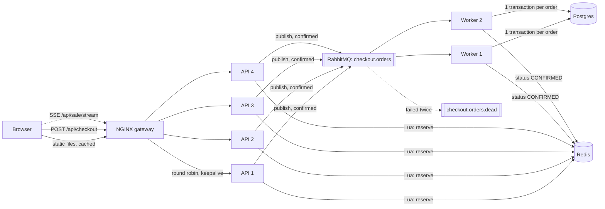

# Architecture

## The problem with the old design

The old checkout did roughly this inside the HTTP request:

```sql
SELECT stock FROM inventory WHERE product_id = :id;   -- reads 37
-- application checks stock > 0
UPDATE inventory SET stock = 36 WHERE product_id = :id;
INSERT INTO orders ...;
```

Under load, many requests read the same value (say 37) before any of them writes. They all decide there is stock, all write 36 and all insert an order. That is how 500 phones became 540 orders. Every request also held a database connection and contended for the same inventory row, which is where the row locks and timeouts came from. Loading the product, the stock and the user one query at a time per request (an N+1 pattern) made each request slower still.

The fix has two parts:

1. **Make "check and take" a single atomic step**, so no two buyers can see the same unit as free.
2. **Take the database out of the request path**, so 100,000 requests don't turn into 100,000 transactions fighting over one row.

## Components



| Component | Role | Scales by |
|---|---|---|
| NGINX | Serves the frontend (CDN stand-in), per-IP rate limits, bot filter, load balancing | More instances behind a cloud load balancer |
| API (Node, Fastify) | Validates the request, runs the Redis script, publishes to the queue, replies 202 | Adding replicas. No state lives in the process |
| Redis | Stock counter, buyer set, idempotency keys, order status, sale config | Replica + Sentinel, or Cluster (keys use `{saleId}` hash tags) |
| RabbitMQ | Durable queue between "accepted" and "written to the database" | Quorum queues on a 3-node cluster |
| Worker | Reads one message at a time and writes the order in a transaction | More workers. The database only sees as many writes as there are units |
| Postgres | Source of truth for stock and orders, with constraints that forbid overselling | Not on the hot path, so one primary is plenty |

## Checkout, step by step

```mermaid
sequenceDiagram
  participant B as Browser
  participant G as NGINX
  participant A as API
  participant R as Redis
  participant Q as RabbitMQ
  participant W as Worker
  participant P as Postgres

  B->>G: POST /api/checkout (Bearer token, Idempotency-Key)
  G->>G: bot filter, per-IP rate limit
  G->>A: forward to any replica
  A->>A: verify token, check sale has started
  alt this replica already knows stock is 0
    A-->>B: 409 SOLD_OUT (no Redis call)
  end
  A->>R: EVALSHA reserve (atomic)
  R-->>A: RESERVED / SOLD_OUT / ALREADY_PURCHASED / DUPLICATE
  A->>Q: publish order (persistent, wait for broker confirm)
  A-->>B: 202 Accepted, Location: /api/orders/{id}
  Q->>W: deliver (prefetch 1)
  W->>P: BEGIN; INSERT order ON CONFLICT DO NOTHING;<br/>UPDATE inventory SET stock = stock - 1 WHERE stock > 0; COMMIT
  W->>R: order status = CONFIRMED
  W->>Q: ack
  loop backoff with jitter
    B->>G: GET /api/orders/{id}
    G->>A: 
    A->>R: HGETALL order
    A-->>B: PENDING / CONFIRMED
  end
```

### The reserve script

All of this runs inside Redis as one step ([`server/src/scripts.ts`](../server/src/scripts.ts)). Redis executes one script at a time, so there is no gap between reading the stock and taking a unit.

```lua
if idempotency key already used  -> return DUPLICATE, existing order id
if this user already has an order -> return ALREADY_PURCHASED, existing order id
if stock <= 0                     -> return SOLD_OUT
DECR stock
record user -> order, key -> order
order status = PENDING
return RESERVED
```

### What happens when something fails

| Failure | What happens |
|---|---|
| Double click / network retry | Same `Idempotency-Key`, so the script returns the same order (`DUPLICATE`). No second unit is taken |
| Same customer, new tab | New key, but the user already has an order: `409 ALREADY_PURCHASED` with a link to it |
| RabbitMQ publish fails | The API runs the `release` script (puts the unit back, removes the user's hold) and returns `503` with `Retry-After`. The browser can retry with the same key |
| API replica loses RabbitMQ | It exits and Docker restarts it. Other replicas keep serving |
| Worker crashes after commit, before ack | RabbitMQ redelivers. The `INSERT ... ON CONFLICT DO NOTHING` finds the order already there, so stock is not taken twice |
| Database or Redis error in the worker | Message is requeued once; if it fails again it goes to the dead-letter queue for inspection (visible on `/ops`) |
| Database refuses the decrement (stock already 0) | Order rolled back, the unit hold is released in Redis, the order status becomes `FAILED`. With Redis as the gate this should not happen; it is the last safety net |
| Redis restarts | Append-only file with fsync every second |

## Data model

[`infra/db/init.sql`](../infra/db/init.sql)

```sql
inventory (product_id PK, stock int CHECK (stock >= 0), version int)
orders    (id uuid PK, sale_id, product_id, user_id, idempotency_key, status, strategy, created_at,
           UNIQUE (sale_id, user_id),
           UNIQUE (sale_id, idempotency_key))
```

Redis keys for one sale, all tagged with `{saleId}` so they land on the same Cluster slot:

| Key | Type | Content |
|---|---|---|
| `sale:current` | hash | sale id, start time, total stock, strategy |
| `sale:{id}:stock` | string | units left |
| `sale:{id}:buyers` | hash | user id → order id |
| `sale:{id}:idem` | hash | idempotency key → order id |
| `sale:{id}:order:{orderId}` | hash | status, user id, timestamps (24 h TTL) |

## Frontend

- **Size**: the app is written against the React API and built with Preact's compatibility layer. 45 KB of JS and CSS (17.5 KB gzipped). `npm run build` fails above 200 KB ([`web/scripts/check-bundle.mjs`](../web/scripts/check-bundle.mjs)). The ops page is a separate chunk that shoppers never download.
- **Clock**: the countdown uses the server's time (an offset measured at load), so a customer with a wrong phone clock still sees the right countdown.
- **Live updates**: one Server-Sent Events stream per browser. Each API replica reads Redis once every 500 ms and pushes to all its connected browsers only when something changed. If the stream fails three times in a row, the page switches to polling every 2 to 3 seconds.
- **Buy button**: a small state machine ([`web/src/checkout-machine.ts`](../web/src/checkout-machine.ts)). The first click moves it to `submitting`, and any further click is ignored. A ref also blocks clicks that land in the same frame, before React re-renders.
- **After 202**: the page shows "A unit is reserved for you" right away (optimistic), then polls the order with exponential backoff (400 ms doubling to 4 s) plus random jitter, so thousands of browsers do not poll in lockstep.
- **Caching and prefetch**: hashed assets are served with `Cache-Control: public, max-age=31536000, immutable`, and `index.html` with `no-cache`. The product image is preloaded in `<head>`. The ops chunk is prefetched when the user hovers over the link.

## Production notes

What would change on a real deployment, without changing the design:

- CloudFront or Cloudflare in front, serving the static files from the edge and providing WAF and bot management. NGINX rate limits stay as a second layer. Trust `X-Forwarded-For` only from the CDN's IP ranges (locally we trust the Docker network so the load test can simulate many clients).
- An AWS ALB or GCP load balancer in front of an auto-scaling group (or Kubernetes deployment) of API pods. The API holds no state, so scaling is a replica count.
- Redis with a replica and Sentinel (or ElastiCache). RabbitMQ with quorum queues on 3 nodes.
- Add a waiting room only if traffic outgrows the gateway. The 409 sold-out path is already served from memory.
- Metrics to Prometheus or Grafana instead of the Redis counters behind `/ops`, and error reporting to Sentry or Rollbar.
