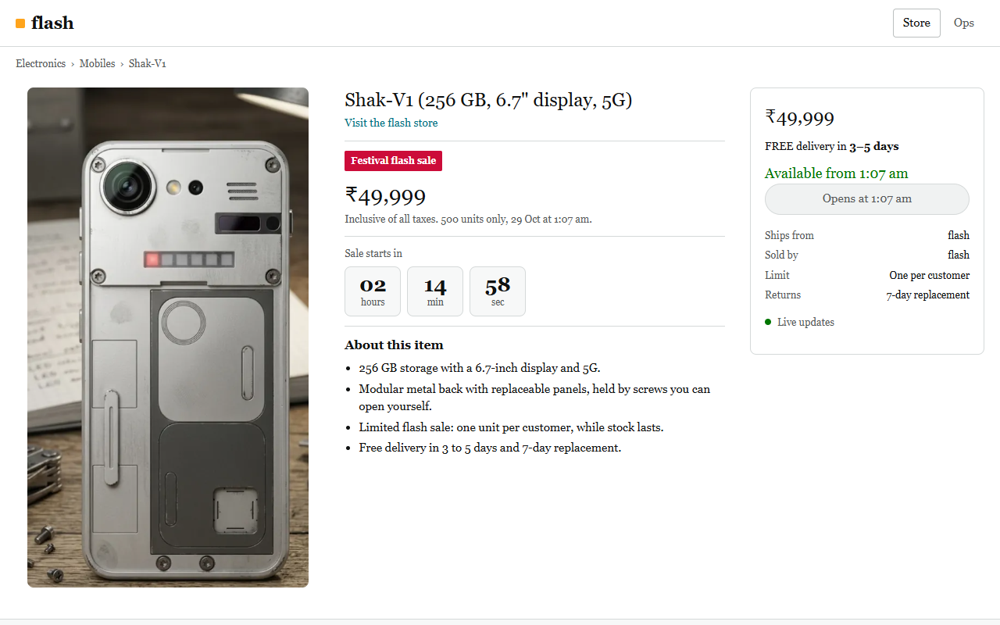
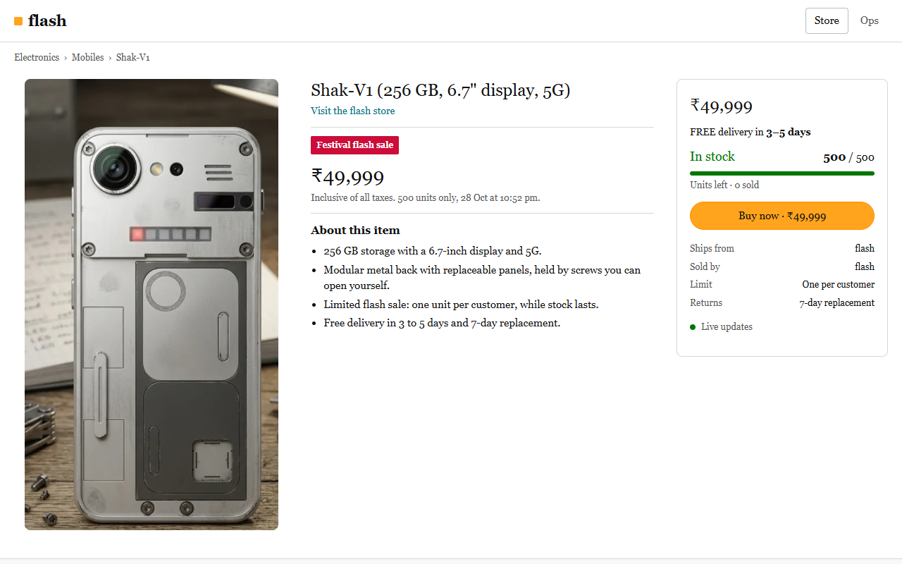
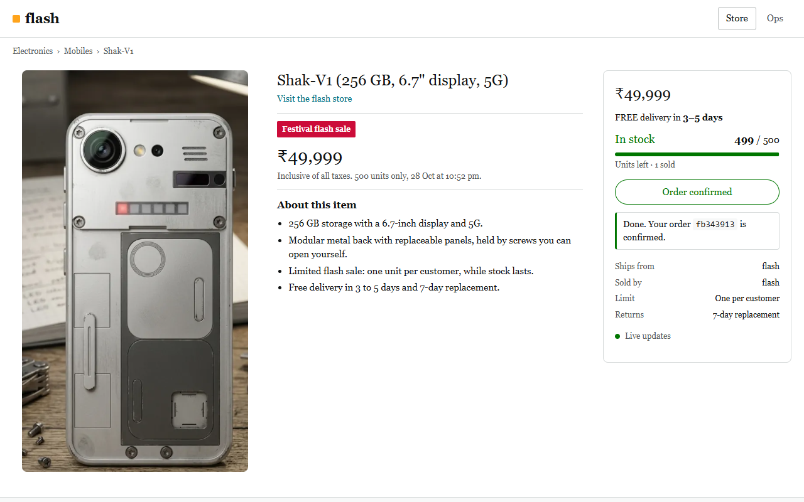
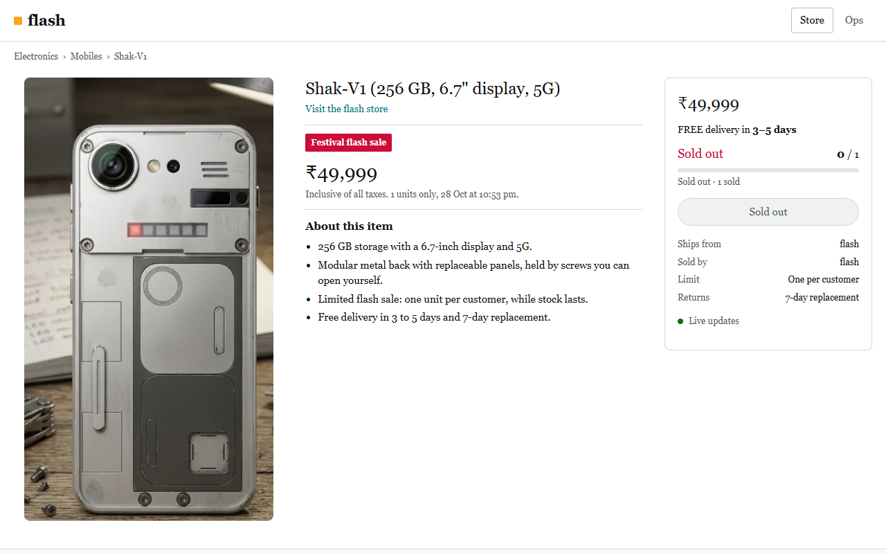
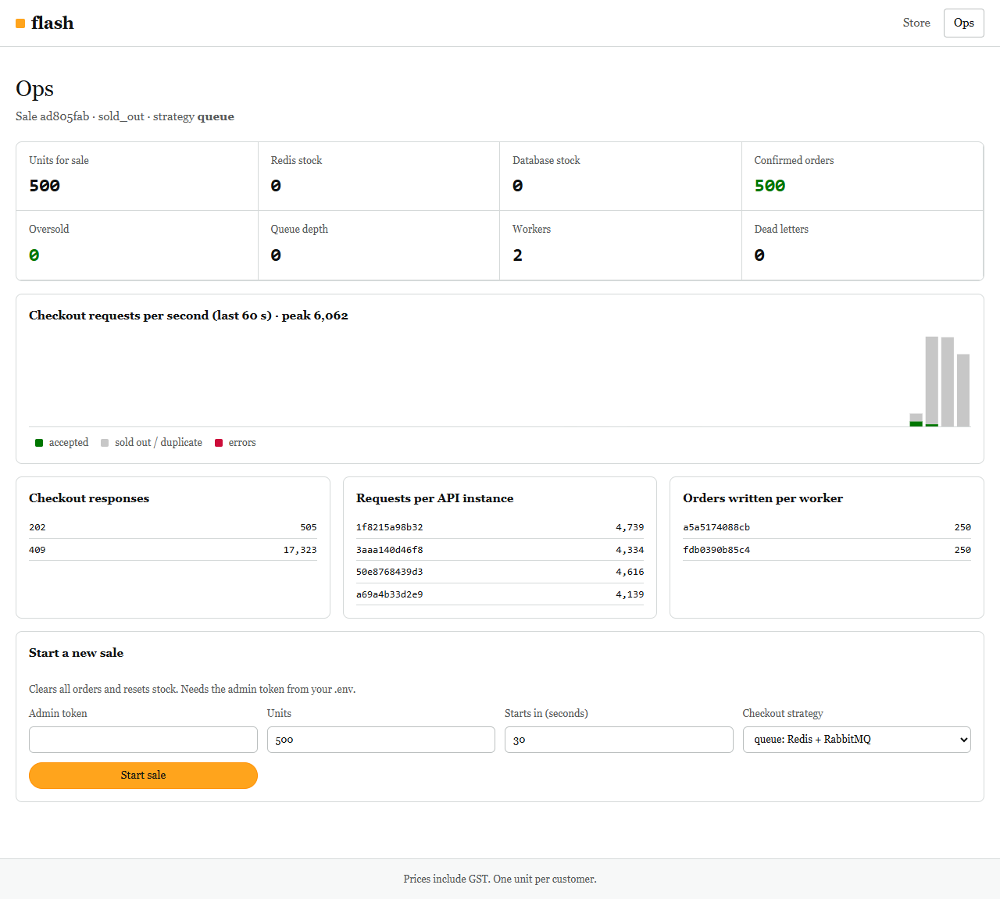
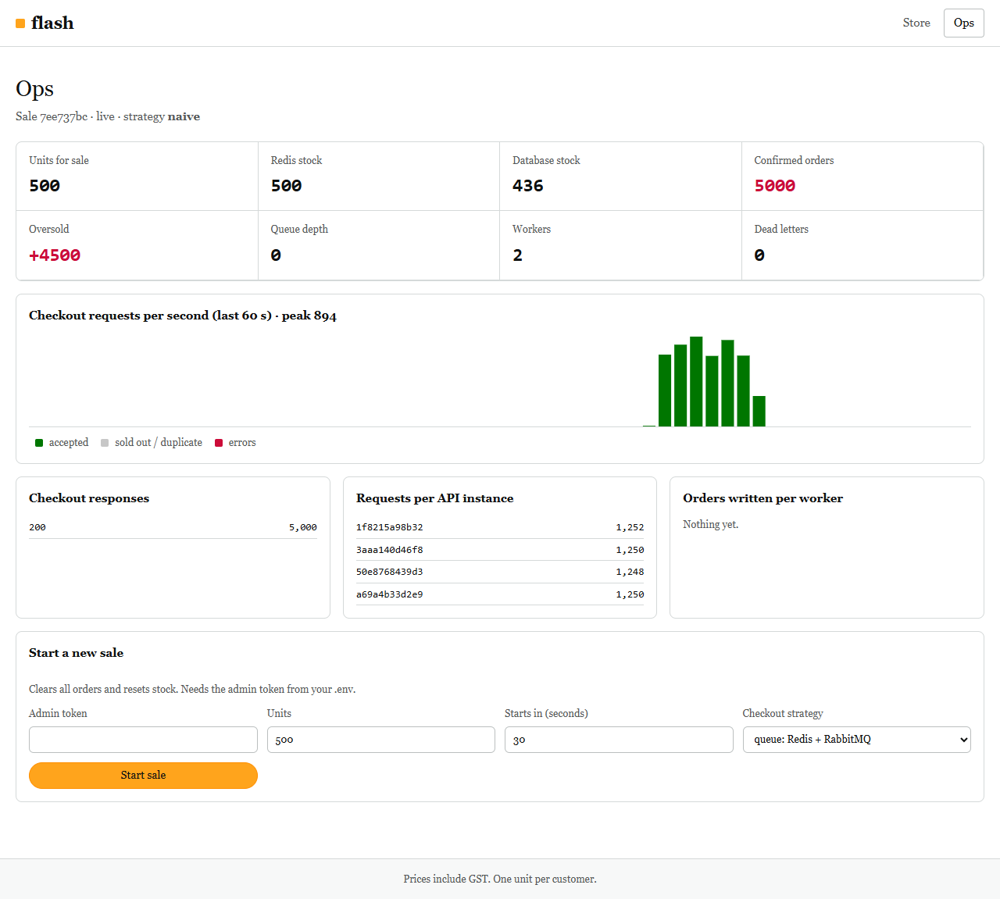

# Testing

Everything runs against the real stack (`docker compose up -d --build`): NGINX, 4 API replicas, 2 workers, Redis, RabbitMQ and Postgres. There are no mocks in the API, load or browser tests.

On Git Bash for Windows, set `MSYS_NO_PATHCONV=1` before the k6 commands so the container paths are not rewritten.

## 1. API tests: REST Assured + JUnit 5

`tests/api/` · 18 tests · run in a Maven container on the compose network, so nothing needs installing:

```
docker compose --profile test run --rm api-tests
```

| Class | What it checks |
|---|---|
| `CheckoutApiTest` | Sale view contract; `425` before start; `202` + `Location` then `CONFIRMED` via the worker; idempotent retry returns the same order; one order per customer; `409 SOLD_OUT`; `401` on missing or forged tokens; `400` on a bad idempotency key; an order is visible only to its owner (`404` for others); admin auth and input validation; malformed requests get 4xx, never 500 |
| `GatewayTest` | Bot user agents get `403`; one IP hammering gets `429` while other IPs are served; traffic reaches several replicas; hashed assets have `immutable` cache headers |
| `ConcurrencyTest` | 1,000 buyers released at the same instant (100 threads) for 50 units, per strategy. `queue`: exactly 50 `202`, 950 `409`, then 50 orders and stock 0 in both stores, empty queue, no dead letters. `naive`: oversells (the original bug). `pessimistic`: exactly 50. `optimistic`: never more than 50 |

Last run: **18 passed, 0 failed** ([`evidence/api-tests/rest-assured-run.txt`](../evidence/api-tests/rest-assured-run.txt), JUnit XML in [`evidence/api-tests/surefire/`](../evidence/api-tests/surefire/)).

```
[queue]       1000 buyers, 50 units -> responses {202=50, 409=950}
[naive]       1000 buyers, 50 units -> responses {200=1000}   confirmed orders: 1000 for 50 units
[pessimistic] 1000 buyers, 50 units -> responses {200=50, 409=950}
[optimistic]  1000 buyers, 50 units -> responses {200=50, 409=950}
```

## 2. Load test: k6

### The 8 PM burst

```
docker compose --profile test run --rm k6 run --summary-export=/results/flash-sale-summary.json /scripts/flash-sale.js
```

- 100,000 checkout requests with 100 virtual users (requests in flight at a time). Each request is a different customer with a different client IP.
- At the same time, a bot sends 100 requests per second from one IP for 10 seconds.
- Thresholds (the run fails if any is missed): every request answered, zero 5xx, zero no-response, buyer p95 < 100 ms and p99.9 < 100 ms, more than 90% of bot requests rate-limited. After the queue drains: exactly 500 orders, stock 0 in Postgres and Redis, nothing dead-lettered.

Three runs back to back. Run 1 ([`evidence/k6/flash-sale-run.txt`](../evidence/k6/flash-sale-run.txt)):

```
buyers ✓ [ 100% ] 100 VUs    0m07.2s/1m30s  100000/100000 shared iters
FINAL confirmedOrders=500 dbStock=0 redisStock=0 queue={"depth":0,"consumers":2,"deadLetters":0}
  ✓ exactly 500 confirmed orders
  ✓ database stock is 0
  ✓ redis stock is 0
  ✓ queue drained, nothing dead-lettered
✓ checkout_answered.........: 100.00% 100000 out of 100000
✓ checkout_server_errors_5xx: 0
✓ checkout_no_response......: 0
✓ bot_requests_blocked......: 97.40%
✓ { scenario:buyers }.......: med=4.65ms p(90)=13.63ms p(95)=18.46ms p(99)=32.44ms p(99.9)=65.16ms max=827.61ms
```

| Run | Burst | Median | p95 | p99 | p99.9 | Slowest | Files |
|---|---|---|---|---|---|---|---|
| 1 | 7.2 s | 4.7 ms | 18.5 ms | 32.4 ms | 65.2 ms | 828 ms | `flash-sale-run.txt`, `flash-sale-summary.json` |
| 2 | 7.1 s | 4.9 ms | 17.8 ms | 29.9 ms | 49.6 ms | 134 ms | `flash-sale-run-2.txt`, `flash-sale-summary-2.json` |
| 3 | 7.7 s | 5.3 ms | 19.8 ms | 32.2 ms | 58.5 ms | 132 ms | `flash-sale-run-3.txt`, `flash-sale-summary-3.json` |

All three passed every threshold, with exactly 500 orders and 25,004 to 25,010 requests on each of the 4 API replicas.

### The slowest request

The p99.9 is stable; the single slowest request is not. About 25 diagnostic runs, which logged every request over 50 ms, showed:

- Every slow request was a "sold out" answer served from the API's memory. That path takes about 5 ms and touches neither Redis nor the database.
- Garbage collection is not the cause: with `--trace-gc` on, the longest pause in any API process during a burst was 10 ms.
- Slow requests arrive in clusters of 50 to 300 ms, sometimes on one API replica and sometimes on all of them at once. These are moments when the operating system (and Windows under Docker's VM) pauses a process while about 20 busy processes share 8 cores. They are worst in the first second, when the 500 orders are also being written.
- RabbitMQ's Erlang schedulers were spinning while idle and using 1 to 1.6 cores. They are now told not to (`RABBITMQ_SERVER_ADDITIONAL_ERL_ARGS` in `docker-compose.yml`), which also made the burst faster (about 7.5 s instead of 9 s).
- Tried and not kept, because they made no clear difference or made it worse: 4 NGINX workers instead of 8, a larger Node young-generation heap, less frequent garbage collection in k6, higher CPU priority for the API, NGINX and Redis, and pinning containers to separate cores.
- Freshly started API processes are slower until their code is compiled. One unrecorded warm-up run right after the APIs restarted had p99.9 122 ms, which fails the threshold. Run 1 above came right after an API replica rejoined the load balancer, and its 828 ms is most likely the same effect.

Getting the slowest request reliably under 100 ms needs the load generator on a separate machine, as it would be in a real test.

### Why 100 requests in flight

The first version kept 1,200 requests in flight ([`flash-sale-run-1200vus.txt`](../evidence/k6/flash-sale-run-1200vus.txt)): 100,000 requests in 8.8 s, median 55 ms, p95 191 ms, slowest 1.03 s. The machine can only complete about 11,000 requests per second, so extra requests in flight just wait in line, and latency grows with no gain in throughput. The same burst at different levels (measured before the RabbitMQ change above):

| Requests in flight | Median | p90 | p95 | Slowest | Summary file |
|---|---|---|---|---|---|
| 1,200 | 55.6 ms | 144.9 ms | 191.6 ms | 1,028 ms | `flash-sale-summary-1200vus.json` |
| 400 | 28.8 ms | 96.5 ms | 139.4 ms | 2,188 ms | `tuning-vus400-summary.json` |
| 200 | 9.4 ms | 28.2 ms | 36.6 ms | 194 ms | `tuning-vus200-summary.json` |
| 100 | 5.0 ms | 14.7 ms | 19.2 ms | 112 ms | `tuning-vus100-summary.json` |

Every run had exactly 500 orders, 100% answered and 0 errors.

The ops-page screenshots were taken during a separate run, with Chrome capturing the page at the same time ([`flash-sale-run-while-screenshotting.txt`](../evidence/k6/flash-sale-run-while-screenshotting.txt)): 100,000 requests in 10.8 s, exactly 500 orders, stock 0 in Redis and Postgres. With the browser also using CPU, its p99.9 was 102 ms, so that run missed the 100 ms threshold by 2 ms.

**About the numbers.** Everything ran on one 8-core laptop, with k6 competing for CPU with NGINX, the API replicas and the databases. The first attempt used a fixed arrival rate of 10,000 requests per second. k6 itself could not generate that rate on this machine and reported dropped iterations on its side, while the server still answered every request it received. So the test was changed to send exactly 100,000 requests as fast as possible, which reached about 11,000 per second. Real capacity numbers would need the load generator on separate machines.

### Oversell Lab

```
bash tests/load/run-lab.sh
```

The same burst (5,000 buyers, 500 units, 200 concurrent clients) against each strategy. The script writes [`evidence/k6/lab-results.md`](../evidence/k6/lab-results.md):

| Strategy | Buyers | Units | Orders confirmed | Oversold | Conflicts (409) | Errors | Median ms | p95 ms | Max ms | Req/s |
|---|---|---|---|---|---|---|---|---|---|---|
| naive | 5000 | 500 | 5000 | **+4500** | 0 | 0 | 266.7 | 448.0 | 697 | 547 |
| pessimistic | 5000 | 500 | 500 | 0 | 0 | 0 | 259.2 | 468.1 | 1304 | 547 |
| optimistic | 5000 | 500 | 167 | 0 | 4833 | 0 | 261.4 | 412.7 | 632 | 523 |
| queue | 5000 | 500 | 500 | 0 | 0 | 0 | 18.8 | 74.3 | 146 | 1174 |

### RabbitMQ restart

```
bash tests/resilience/rabbitmq-restart.sh
```

Restarts RabbitMQ under the running stack, then checks that both workers consume again and that a new order still reaches `CONFIRMED`. It found a bug: on a lost connection the worker kept running but consumed nothing, so orders stayed in the queue (`FAIL: checkout.orders has 0 consumers, expected 2`). The worker now exits on a lost connection and Docker restarts it, the same way the API already did. Last run: pass ([`evidence/resilience/rabbitmq-restart-run.txt`](../evidence/resilience/rabbitmq-restart-run.txt)).

Also found while running it, not fixed yet: NGINX resolves the `api` name once at startup. If an API container restarts and comes back on a different IP, NGINX stops sending it traffic until the gateway restarts. No requests fail (the other replicas answer), but the load is spread over fewer replicas. The fix is to let NGINX re-resolve the name (`resolver 127.0.0.11` with `resolve` on the upstream server).

## 3. Browser tests: Playwright

```
cd tests/e2e
npm ci
npx playwright install chromium        # or set PW_CHANNEL=chrome to use an installed Chrome
npx playwright test
```

| Test | Checks |
|---|---|
| Countdown before 8 PM | Timer visible, button disabled, live feed connected (desktop and mobile screenshots) |
| Sale opens | The button enables by itself when the start time passes, with no reload |
| Rapid clicks | Five clicks in one frame produce exactly **one** `/api/checkout` request; the order reaches "confirmed"; stock shows 499; after a reload the same customer is told they already have an order |
| Last unit | One buyer gets it; the other shopper's page switches to "Sold out" by itself via SSE |
| Ops page | Confirmed orders, Redis stock and database stock agree |

Last run: **5 passed** ([`evidence/e2e/playwright-run.txt`](../evidence/e2e/playwright-run.txt), HTML report in [`evidence/e2e/report/`](../evidence/e2e/report/)).

## 4. Unit tests: Vitest

```
cd web && npm test
```

6 tests for the buy-button state machine: locks after the first click, 202 → queued → confirmed, the mapping of 409/425/429, retry reuses the idempotency key, network errors are retryable, and no buying again after a final result.

## 5. Frontend performance: Lighthouse

```
npx lighthouse http://localhost:8080/ --only-categories=performance
```

| Profile | Score | FCP | LCP | Time to Interactive | TBT | Transferred |
|---|---|---|---|---|---|---|
| Mobile (Lighthouse default throttling) | 100 | 1.1 s | 1.4 s | **1.4 s** (1,433 ms) | 0 ms | 42 KiB |
| Desktop | 100 | 0.3 s | 0.3 s | **0.3 s** | 0 ms | 42 KiB |

Reports: [`evidence/lighthouse/`](../evidence/lighthouse/).

## Screenshots

| | |
|---|---|
|  |  |
| Before the sale | Sale open |
|  |  |
| Order confirmed | Another shopper after the last unit |
|  |  |
| Ops page during the 100k run | Ops page after a run with the naive strategy |
